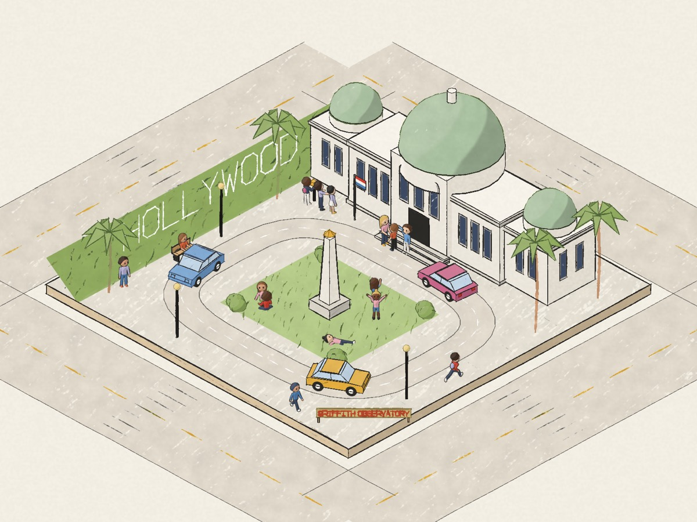

# Paper City room: a skill for chat agents

Paper City is a city drawn by hand in pencil and wax crayon, live in the browser. This skill teaches an agent to
draw one block of it, a **room**: a landmark, the ground around it, a dozen or so people and a few things that
move. The agent writes one small JavaScript file; the Paper City engine (bundled here as one HTML file) draws it.
No image or video model is used.

## In fal Agent

1. **Skills → Install skill → From GitHub**, and paste
   `https://github.com/kevintngo/paper-city-skill/tree/main/paper-city-room`
2. In any chat, name a place:

   > Draw a Paper City room for Galata Tower, Istanbul

3. When the zip arrives, press **Open preview**, then **Run preview**: the room plays in the panel to the right
   of the chat. Drag to move around, scroll to zoom.
4. Ask for changes ("more people at the café", "add a ferry") or for the next place.

A room takes the agent about four minutes.

## In other agents

The folder `paper-city-room/` follows the [Agent Skills](https://agentskills.io) layout (`SKILL.md` plus its
files), so it can be dropped into any agent that reads skills. Or attach it as a zip and say "read
paper-city-room/SKILL.md and draw a Paper City room for …".

## What is in it

- `SKILL.md`: the steps, from the user's few words to the delivered preview.
- `build.py`: checks `room.js`, pastes it into the viewer, zips the result (Python, standard library only).
- `viewer.html`: the Paper City engine in one self-contained file, made to run inside a locked-down preview frame.
- `references/`: the room API on one page, recipes, every ready-made part, and finished rooms to read.
- `images/`: what a good room looks like, and two mistakes to avoid.
